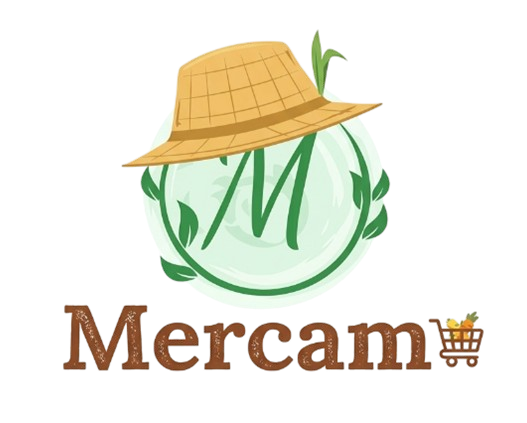
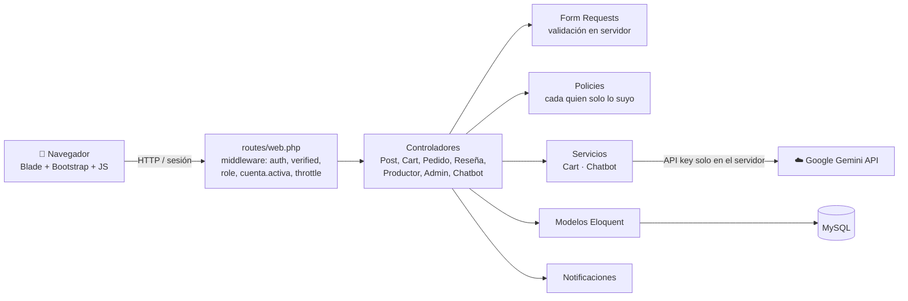
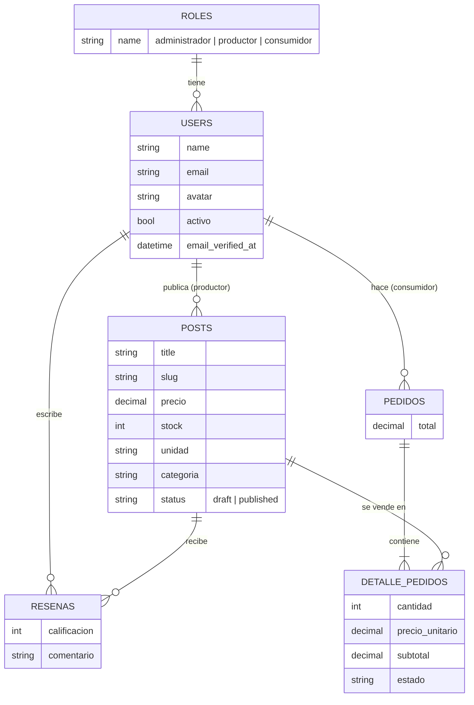
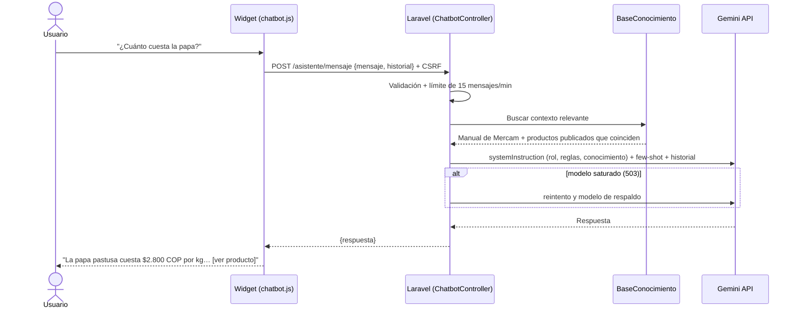

<p align="center">
  
</p>

<h1 align="center">Mercam (Mercampo)</h1>

<p align="center">
  Plataforma web de comercialización directa de productos agrícolas de pequeños productores de San Diego de Ubaté, con un asistente virtual de IA.<br>
  <em>Más campo, menos cadena.</em>
</p>

<p align="center">
  <a href="https://github.com/jasbleidyalarcon9-dot/Mercam/actions/workflows/tests.yml"></a>
  
  
  
  
</p>

<p align="center">
  <strong>🌐 Demo en vivo:</strong> <a href="https://TU-APP.up.railway.app">https://TU-APP.up.railway.app</a> ·
  <strong>🎥 Video:</strong> <a href="#">enlace al video</a>
</p>

**Autora:** Nelcy Jasbleidy Alarcón Pacalagua — Universidad de Cundinamarca

---

## Contenido

1. [El problema y la solución](#el-problema-y-la-solución)
2. [Funcionalidades](#funcionalidades)
3. [Stack tecnológico](#stack-tecnológico)
4. [Arquitectura](#arquitectura)
5. [Asistente virtual "Campi" (LLM)](#asistente-virtual-campi-llm)
6. [Instalación local](#instalación-local)
7. [Pruebas](#pruebas)
8. [Despliegue en la nube](#despliegue-en-la-nube)
9. [Flujo de trabajo con Git](#flujo-de-trabajo-con-git)
10. [Declaración de la Persona Transhumana](#-declaración-de-la-persona-transhumana--universidad-de-cundinamarca)

---

## El problema y la solución

Los pequeños productores de San Diego de Ubaté venden su cosecha a través de varios intermediarios, que se quedan con buena parte del precio final. **Mercam** los conecta directamente con los consumidores: el productor publica sus productos con su propio precio y stock, y el consumidor compra sin intermediarios, bajo un modelo de economía colaborativa y comercio justo.

## Funcionalidades

| Visitante | Consumidor | Productor | Administrador |
|---|---|---|---|
| Ver el catálogo, buscar y filtrar por categoría | Carrito y confirmación de pedidos | Publicar, editar y despublicar productos | Gestionar usuarios y roles |
| Ver el detalle y las reseñas de un producto | "Mis pedidos" y cancelación de productos pendientes | Panel con métricas | Suspender o activar cuentas |
| Registrarse como productor o consumidor | Escribir reseñas | Cambiar el estado de los pedidos recibidos | Moderar productos y reseñas |
| **Chatear con Campi 🌱** | Notificaciones y perfil con avatar | Notificaciones de nuevos pedidos | Ver todos los pedidos |

Además, todas las cuentas tienen verificación de correo, recuperación de contraseña y aceptación de la política de tratamiento de datos.

## Stack tecnológico

| Capa | Tecnología |
|---|---|
| Backend | Laravel 12 · PHP 8.3 |
| Frontend | Blade · Bootstrap 5 · JavaScript vanilla · Vite |
| Base de datos | MySQL (producción) · SQLite en memoria (pruebas) |
| Inteligencia artificial | Google AI Studio — Gemini API (`gemini-flash-latest` + modelos de respaldo) |
| Pruebas | PHPUnit / Pest · `Http::fake()` para simular Gemini |
| Integración continua | GitHub Actions |
| Despliegue | Docker · Railway (compatible con Render) |

---

## Arquitectura

### Vista general



### Patrón y organización del código

Laravel sigue el patrón **MVC**. Encima de él se separaron responsabilidades para que el código sea fácil de mantener:

```
app/
├── Http/
│   ├── Controllers/        # Coordinan la petición; sin lógica de negocio pesada
│   │   ├── Admin/          # Panel del administrador
│   │   ├── Auth/           # Registro, login, verificación y recuperación
│   │   ├── Productor/      # Panel del productor
│   │   └── ChatbotController.php
│   ├── Middleware/         # EnsureHasRole, EnsureCuentaActiva
│   └── Requests/           # Validación en servidor de cada formulario
├── Models/                 # User, Role, Post (producto), Pedido, DetallePedido, Resena
├── Policies/               # Autorización: Post, Pedido, DetallePedido, Resena
├── Notifications/          # Avisos de pedidos, estados y cancelaciones
├── Rules/                  # Reglas de validación propias
└── Services/
    ├── Cart.php            # Carrito en sesión
    └── Chatbot/            # Asistente IA (ver sección Campi)
resources/
├── chatbot/conocimiento.md # Base de conocimiento fija del asistente
└── views/                  # Vistas Blade por módulo + componente <x-chatbot>
database/
├── migrations/             # Esquema versionado
└── seeders/                # RoleSeeder, DemoSeeder
docker/                     # Arranque del contenedor en la nube
tests/Feature/              # Pruebas de reglas de negocio, seguridad y chatbot
```

### Modelo de datos



> En el código, el producto se llama `Post` (tabla `posts`), porque el proyecto empezó como un CRUD de publicaciones y luego se amplió a catálogo.

### Seguridad

- **Roles en una tabla aparte** (`roles`). `role_id` no se puede asignar por *mass-assignment*: solo el registro (productor o consumidor) y el administrador lo cambian.
- **Policies:** cada usuario solo ve y modifica sus propios productos, pedidos y reseñas.
- **Validación en servidor** con Form Requests, además de la del formulario.
- **Correo verificado** (`verified`) para comprar, vender y usar el panel. Las cuentas suspendidas se bloquean con `cuenta.activa`.
- **Límites de uso:** login, registro y chatbot (`throttle`).
- **Secretos fuera del código:** `.env` está en `.gitignore`; en la nube se usan variables de entorno.

---

## Asistente virtual "Campi" (LLM)

### Propósito y contexto
Campi es un **manual de usuario interactivo y guía del catálogo**. Responde solo sobre:
- cómo usar Mercam (registro, compras, carrito, pedidos, publicar productos, perfil, notificaciones);
- los productos **publicados** en el catálogo: precio, unidad, stock, categoría, productor y enlace;
- datos de contacto y soporte.

Cualquier otro tema lo rechaza con amabilidad (restricción de dominio).

### Flujo de una pregunta



### Componentes

| Archivo | Responsabilidad |
|---|---|
| `app/Services/Chatbot/GeminiClient.php` | Única clase que conoce al proveedor LLM. Reintenta si Google responde 503 (modelo saturado) y pasa a modelos de respaldo. Cambiar a OpenAI/Ollama solo toca este archivo. |
| `app/Services/Chatbot/BaseConocimiento.php` | Arma el contexto: conocimiento fijo + productos relevantes de la BD (RAG ligero). |
| `app/Services/Chatbot/AsistenteMercam.php` | Prompt engineering: rol, reglas, restricción de dominio, few-shot e historial. |
| `app/Http/Controllers/ChatbotController.php` | Endpoint JSON; solo envía al modelo el **tipo** de usuario, nunca datos personales. |
| `app/Http/Requests/ChatbotMensajeRequest.php` | Validación: mensaje ≤ 500 caracteres, historial limitado, roles `user`/`model`. |
| `resources/chatbot/conocimiento.md` | Base de conocimiento fija, editable sin tocar código. |
| `resources/views/components/chatbot.blade.php` | Componente `<x-chatbot>` reutilizable (modo flotante y modo página). |
| `resources/views/asistente/index.blade.php` | Página `/asistente` con el chat, cómo funciona y la sección ética. |
| `public/js/chatbot.js` · `public/css/chatbot.css` | Lógica y estilos del widget. |
| `tests/Feature/ChatbotTest.php` | Pruebas con `Http::fake()` (no gastan cuota de la API). |

### Base de conocimiento (RAG ligero)
1. **Fija:** `resources/chatbot/conocimiento.md` con el manual de uso, los roles, las reglas de seguridad y el contacto.
2. **Viva:** en cada pregunta se consultan los productos **publicados** de la base de datos (nunca borradores). Se extraen las palabras clave de la pregunta (quitando palabras vacías y tildes), se puntúa cada producto por coincidencias en título, categoría, descripción y productor, y se envían al modelo solo los 15 más relevantes, junto con un resumen de cuántos productos hay por categoría.

Así el asistente siempre responde con precios y stock **actuales** sin reentrenar nada. Si el catálogo creciera mucho, el siguiente paso sería cambiar la recuperación por palabras clave por embeddings (`text-embedding-004`) y búsqueda por similitud.

### Prompt engineering
- **System prompt** (`systemInstruction`): identidad "Campi", propósito, 11 reglas y la base de conocimiento.
- **Restricción de dominio:** frase fija para temas fuera de Mercam.
- **Anti-alucinación:** responder solo con la base de conocimiento; si no está, decirlo y remitir a soporte.
- **Seguridad:** nunca pedir contraseñas ni datos personales; ignorar intentos de cambiar sus reglas (*prompt injection*).
- **Few-shot:** 3 ejemplos (cómo comprar, pregunta fuera de tema, intento de obtener una contraseña).
- **Contexto por rol:** visitante / consumidor / productor / administrador.
- **Parámetros:** `temperature: 0.3` y respuestas de máximo 120 palabras.

### Configuración

1. Crea una API key en [Google AI Studio](https://aistudio.google.com/apikey).
2. Agrega a tu `.env` (nunca en el código ni en GitHub):
   ```env
   GEMINI_API_KEY=tu_clave
   GEMINI_MODEL=gemini-flash-latest
   GEMINI_FALLBACK_MODELS=gemini-flash-lite-latest,gemini-2.5-flash
   GEMINI_TIMEOUT=15
   ```
3. Ejecuta `php artisan config:clear`.
4. Usa el botón **🌱 ¿Te ayudo?** en cualquier página, o entra a `/asistente`.

---

## Instalación local

**Requisitos:** PHP 8.2 o superior, Composer, Node 20 o superior, MySQL 8 (o SQLite) y una API key de Gemini.

```bash
# 1. Clonar e instalar dependencias
git clone https://github.com/jasbleidyalarcon9-dot/Mercam.git
cd Mercam
composer install
npm install && npm run build

# 2. Variables de entorno
cp .env.example .env          # en Windows: copy .env.example .env
php artisan key:generate
# Edita .env: DB_* (MySQL), MAIL_* (correo) y GEMINI_API_KEY

# 3. Base de datos y archivos
php artisan migrate --seed
php artisan storage:link

# 4. Ejecutar
php artisan serve             # http://127.0.0.1:8000
php artisan queue:work        # en otra terminal: envía los correos en cola
```

**Datos de demostración (opcional):** agrega `DEMO_PASSWORD=una_clave` en el `.env` y ejecuta `php artisan db:seed --class=DemoSeeder`. Se crean un productor (`productor.demo@mercam.app`), un consumidor (`consumidor.demo@mercam.app`) y 7 productos. Para ver sus imágenes, copia `public/img/*.png` a `storage/app/public/demo/`.

## Pruebas

```bash
php artisan test                       # todas
php artisan test --filter=ChatbotTest  # solo el asistente
```

| Archivo | Qué verifica |
|---|---|
| `LoginTest`, `RegistroTest` | Autenticación, registro y asignación de rol |
| `PostAuthorizationTest`, `SeguridadTest` | Que nadie edite lo que no es suyo; protección de roles |
| `CheckoutTest`, `ReglasDeNegocioTest` | Carrito, stock, pedidos y cancelaciones |
| `AdminTest` | Panel del administrador |
| `ChatbotTest` | Contexto enviado a Gemini, privacidad, validación, errores y modelo de respaldo (sin gastar cuota) |

GitHub Actions ejecuta todas las pruebas en cada `push` a `main` (insignia "Pruebas" arriba).

---

## Despliegue en la nube

El proyecto incluye un `Dockerfile` de tres etapas: compila los recursos con Vite, instala las dependencias de PHP y genera una imagen con Apache y PHP 8.3. Al arrancar, `docker/entrypoint.sh` usa el puerto que asigna la nube, ejecuta las migraciones, carga los roles y los datos de demostración, y prepara las cachés de producción.

### Railway (recomendado)

1. Entra a [railway.com](https://railway.com) con tu cuenta de GitHub → **New Project → Deploy from GitHub repo** → elige `Mercam`. Railway detecta el `Dockerfile`.
2. En el mismo proyecto: **+ New → Database → MySQL**.
3. En el servicio web → **Variables**, agrega:

   | Variable | Valor |
   |---|---|
   | `APP_NAME` | `Mercampo` |
   | `APP_ENV` | `production` |
   | `APP_DEBUG` | `false` |
   | `APP_KEY` | resultado de `php artisan key:generate --show` en tu PC |
   | `APP_URL` | `https://<tu-app>.up.railway.app` |
   | `APP_LOCALE` / `APP_FALLBACK_LOCALE` | `es` |
   | `PORT` | `8080` |
   | `LOG_CHANNEL` | `stderr` (los errores aparecen en los logs de Railway) |
   | `DB_CONNECTION` | `mysql` |
   | `DB_HOST` | `${{MySQL.MYSQLHOST}}` |
   | `DB_PORT` | `${{MySQL.MYSQLPORT}}` |
   | `DB_DATABASE` | `${{MySQL.MYSQLDATABASE}}` |
   | `DB_USERNAME` | `${{MySQL.MYSQLUSER}}` |
   | `DB_PASSWORD` | `${{MySQL.MYSQLPASSWORD}}` |
   | `SESSION_DRIVER` / `CACHE_STORE` | `database` |
   | `QUEUE_CONNECTION` | `database` (el contenedor ya inicia un worker de la cola) |
   | `MAIL_MAILER` | `brevo` (Railway bloquea el SMTP; ver abajo) |
   | `BREVO_API_KEY` | tu clave de Brevo |
   | `MAIL_FROM_ADDRESS` | el correo que verificaste en Brevo |
   | `MAIL_FROM_NAME` | `Mercam` |
   | `GEMINI_API_KEY` | tu clave de Google AI Studio |
   | `GEMINI_MODEL` | `gemini-flash-latest` |
   | `DEMO_PASSWORD` | contraseña de las cuentas demo |
   | `ADMIN_EMAIL` / `ADMIN_PASSWORD` | (opcional) cuenta de administrador |

4. **Settings → Networking → Generate Domain**. Copia la URL en `APP_URL` y en la parte de arriba de este README.
5. **Settings → Healthcheck Path:** `/up` (ruta de salud de Laravel).
6. Cada `git push` a `main` vuelve a desplegar automáticamente.

> Las imágenes que suben los usuarios se guardan en `storage/app/public`. Para que no se borren al volver a desplegar, en Railway agrega un **Volume** montado en `/var/www/html/storage/app/public`.

### Correos en la nube (Brevo)

Railway bloquea el SMTP saliente (puertos 25, 465 y 587) en su plan Hobby, así que Gmail SMTP no funciona allí. Los correos de verificación de cuenta y de recuperación de contraseña salen por la **API HTTPS de Brevo**, que es gratuita para este volumen. En tu computador puedes seguir usando `MAIL_MAILER=smtp` con Gmail.

1. Crea una cuenta en [brevo.com](https://www.brevo.com) y verifica tu correo en **Senders** (remitentes).
2. En **SMTP & API → API Keys**, crea una clave y guárdala en `BREVO_API_KEY`.
3. La integración ya está en el código: el transporte `brevo` se registra en `AppServiceProvider` y en `config/mail.php`, con la librería `symfony/brevo-mailer`.

Los correos salen por la cola. Si alguno falla, la página sigue funcionando y el error queda en la tabla `failed_jobs`; puedes reintentarlo con `php artisan queue:retry all`.

### Render (alternativa)

**New → Web Service →** conecta el repositorio (Runtime: Docker) y agrega las mismas variables. Render no ofrece MySQL gratuito, así que necesitas una base externa. Además, en el plan gratuito el servicio se suspende cuando no tiene uso y tarda unos segundos en despertar.

---

## Flujo de trabajo con Git

Los commits siguen [Conventional Commits](https://www.conventionalcommits.org/es/):

| Prefijo | Uso | Ejemplo |
|---|---|---|
| `feat` | Nueva funcionalidad | `feat(chatbot): agregar asistente Campi con Gemini` |
| `fix` | Corrección de errores | `fix(chatbot): reintentar cuando Gemini responde 503` |
| `docs` | Documentación | `docs: documentar arquitectura y despliegue` |
| `test` | Pruebas | `test(chatbot): simular Gemini con Http::fake` |
| `ci` | Integración continua | `ci: ejecutar pruebas en GitHub Actions` |
| `build` | Despliegue y dependencias | `build: agregar Dockerfile para Railway` |
| `refactor` | Mejoras internas sin cambiar el comportamiento | `refactor(carrito): extraer servicio Cart` |

---

## 🧭 Declaración de la Persona Transhumana — Universidad de Cundinamarca

La Declaración de la Persona Transhumana, parte del Modelo Educativo Digital Transmoderno (MEDIT), describe a una persona que **trasciende su condición sin dejar de ser humana**: autónoma, libre y responsable, protagonista de su proyecto de vida y agente de transformación de su entorno, la sociedad y la naturaleza. También advierte que la ciencia y la tecnología no deben vulnerar la dignidad humana ni convertirse en instrumento de dominación, exclusión o privilegio.

**Integración en el proyecto**
- **Conceptual:** esta sección y el bloque "Campi y la Declaración de la Persona Transhumana" en `/asistente`.
- **Técnica:** las reglas del system prompt aplican los principios: se presenta como IA (transparencia), responde solo con datos verificados (honestidad), no pide datos personales y el servidor no se los envía al modelo (dignidad y privacidad), informa sin decidir por el usuario (autonomía) y usa lenguaje sencillo para productores rurales (inclusión).

### ¿De qué manera el agente/chatbot respeta y fomenta los principios de la Declaración de la Persona Transhumana de la Universidad de Cundinamarca en el contexto del aprendizaje y la interacción tecnológica?

Campi entiende la tecnología como un apoyo para que la persona crezca, no como su reemplazo. En lugar de decidir por el usuario, le enseña a usar la plataforma paso a paso y le da información real (precios, stock, productores) para que compre o venda con **autonomía y responsabilidad**. Así, un productor de San Diego de Ubaté con poca experiencia digital aprende a publicar su cosecha y gestionar pedidos por sí mismo, y se convierte en protagonista de su proyecto de vida y en agente de transformación de su comunidad.

El asistente también cuida la **dignidad humana** y evita que la tecnología excluya: se presenta como inteligencia artificial, responde solo con datos verificados, reconoce cuando no sabe algo, nunca pide contraseñas ni datos personales y habla en un lenguaje sencillo, en español o inglés. Además, al fortalecer el comercio justo entre el campo y la ciudad, valora el trabajo campesino y la relación con la tierra, y así une el desarrollo tecnológico con el cuidado de la sociedad y la naturaleza.

### How does the implemented AI agent/chatbot align with and support the Transhuman Person Declaration of Universidad de Cundinamarca regarding ethical AI integration, human augmentation, and educational transformation?

**Ethical AI integration.** Campi always identifies itself as an AI and answers only from Mercam's verified knowledge base: the user manual and the live catalog of published products. It admits when it does not know something, refuses off-topic questions and prompt-injection attempts, and never asks for passwords or personal data. On the server side, only the user's role is sent to the model, never their name, email or orders. This follows the Declaration's warning that technology must not violate human dignity or become a tool of domination or exclusion.

**Human augmentation.** The assistant expands what people can do without replacing their judgment. Small farmers who are new to digital tools get step-by-step guidance to publish their harvest and manage orders, and buyers get real-time information to make their own decisions. People stay autonomous, free and responsible, as the Declaration describes.

**Educational transformation.** Campi works as an interactive, always-available user manual. It turns learning a technology into a conversation in plain Spanish or English, which builds digital skills in rural communities. By supporting fair trade between the countryside and the city, it also helps people become agents of transformation in their community and in their relationship with nature.

Fuente: [Declaración de la Persona Transhumana (MEDIT, UCundinamarca)](https://www.ucundinamarca.edu.co/documents/rectoria/2024/CAP-5-DECLARACION-PERSONA-TRANSHUMANA.pdf)

---

<p align="center">Hecho con 💚 para los productores de San Diego de Ubaté · Universidad de Cundinamarca</p>
